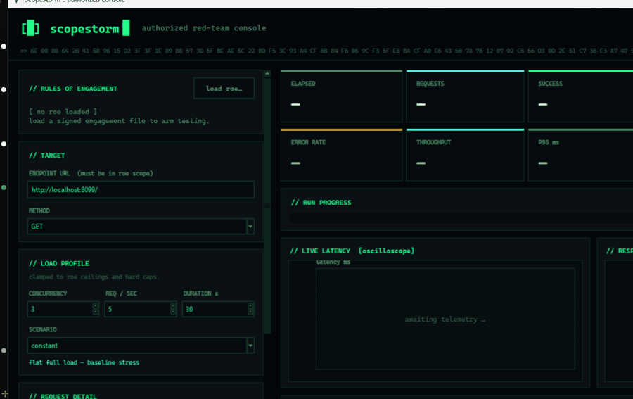

```
  ____                   ____  _
 / ___|  ___ ___  _ __  / ___|| |_ ___  _ __ _ __ ___
 \___ \ / __/ _ \| '_ \ \___ \| __/ _ \| '__| '_ ` _ \
  ___) | (_| (_) | |_) | ___) | || (_) | |  | | | | | |
 |____/ \___\___/| .__/ |____/ \__\___/|_|  |_| |_| |_|
                 |_|

 scopestorm ::  authorized red-team load / resilience console
 scope-locked · audited · auto-abort · deconfliction marker
```

```
$ whoami
> authorized operator only.
```

An **engagement-ready** HTTP load / resilience testing tool for **authorized**
red-team and QA work.

The value here is not raw firepower — it is the **controls around the traffic**
that make a test defensible in a professional engagement: scope enforcement, a
tamper-evident audit trail, deconfliction markers, and automatic safety abort.
It ships as a phosphor-green **operator console** (Tkinter GUI) sitting on top
of an audited engine, plus a matching CLI for automation/CI.

```
!! AUTHORIZED TESTING ONLY !!
```

> ⚠️ Running this against systems you do not own — or lack **written**
> permission to test — is illegal (India IT Act 2000 §43/§66, US CFAA, UK
> Computer Misuse Act, and equivalents worldwide). The tool refuses to run
> against anything not listed in a Rules-of-Engagement file, but that is a
> safety net — **you** are responsible for holding real authorization.

---

## `// WHAT IT DOES` (and deliberately does not)

| Red-team requirement | How it's met |
|---|---|
| **Authorization enforcement** | Won't run without a Rules-of-Engagement (RoE) file. |
| **Scope locking** | Only hosts listed in the RoE can be targeted — every URL, including each hop of a multi-endpoint journey. |
| **Time-window locking** | Optional allowed test window; refuses outside it. |
| **Audit trail** | Hash-chained, tamper-evident JSONL log of the run. |
| **Deconfliction** | Every request carries a marker header + engagement ID so the blue team can tell your test from a real attack. |
| **Auto-abort safety** | Stops automatically if error rate or P95 latency crosses the RoE threshold — you *measure* the breaking point without causing an outage. |
| **Reporting** | JSON engagement report + per-request CSV. |

**Not included, by design** (these are attack techniques, not testing
techniques): IP spoofing / source obfuscation, traffic amplification,
detection evasion, or any way to exceed the hard safety caps.

### `// HARD CAPS` — cannot be raised, even by the RoE

```
  concurrency  ......  25
  request rate ......  20 req/s
  duration     ......  300 s  (5 min)
  timeout      ......  30 s
  body size    ......  64 KB
```

The RoE can only set values **lower** than these.

---

## `// DEMO`



*A full engagement: boot → load RoE (running under the alias `rt-op-7`) →
journey + templating + spike scenario → live oscilloscope → auto-abort at the
degradation knee. Regenerate with `python scripts/make_demo.py`.*

## `// INSTALL`

```bash
$ pip install -r requirements.txt      # just 'requests'; Tkinter ships with Python
```

Pure standard-library otherwise — **zero** other runtime dependencies.
(`requirements-dev.txt` adds Pillow/imageio, needed only to regenerate the demo.)

## `// 01` — write your Rules of Engagement

Copy `roe.example.json` and fill it in with the real engagement details.
`authorized_hosts` is the scope — nothing outside it can be tested.

## `// 02a` — run the GUI console  *(recommended for interactive use)*

```bash
$ python scopestorm_gui.py
```

A green-phosphor operator console — monospace throughout, a pulsing status
core, a live hex data-stream ticker, and a boot sequence. Left pane = config
deck, right pane = live dashboard. Workflow:

```
  [1] load roe…      -> scope, ceilings, window, abort thresholds load in
  [2] set target     -> URL + method  (or a multi-endpoint journey, below)
  [3] pick SCENARIO  -> constant / ramp-up / step / spike / wave / soak
  [4] [x] confirm    -> tick the authorization box
  [5] ▶ EXECUTE      -> watch the oscilloscope, tiles, and request log go live
  [6] export / verify / blue-team view  from the toolbar
```

The dashboard streams live **metric tiles** (throughput, error rate, P95/P99),
a **latency oscilloscope**, a **response-code distribution**, and a scrolling
request log. Error-rate and P95 tiles flash amber/red as the target strains,
and the run **auto-aborts** if it crosses the RoE threshold.

The audit log is written next to the RoE file as `audit_<engagement_id>.jsonl`.

## `// 02b` — run from the CLI  *(automation / CI)*

```bash
$ python scopestorm.py \
    --roe roe.example.json \
    --url https://staging.example.com/health \
    --method GET \
    --pattern spike \
    --report report.json \
    --csv results.csv
```

You'll be shown the plan and asked to type `YES` to confirm authorization
(use `--yes` to skip the prompt in automation/CI).

### `// FLAGS`

| Flag | Meaning |
|---|---|
| `--pattern` | scenario: `constant` `ramp-up` `step` `spike` `wave` `soak` |
| `--concurrency`, `--rps`, `--duration` | override the RoE values *downward* only |
| `--header "Authorization: Bearer ..."` | add auth / custom headers |
| `--endpoint "GET https://host/x"` | journey hop (repeatable) — round-robin across endpoints; each is scope-checked |
| `--template` | inject `{{uuid}}/{{seq}}/{{rand}}/{{ts}}` tokens per request (cache-bust) |
| `--body '{"k":"v"}'` | payload for POST/PUT/PATCH |
| `--audit-log path` | where the tamper-evident log is written |
| `--report path` / `--csv path` | save the engagement report / raw results |

---

## `// SCENARIOS` — resilience load shapes

A scenario only shapes **when** load is applied — it can never exceed the
concurrency / RPS / duration ceilings, so every shape below stays inside the
hard caps. These are legitimate resilience-testing profiles, not attack tools.

```
  constant   ████████████████████████   flat full load — baseline stress
  ramp-up    ▁▂▃▄▅▆▇█                    linear 0→full — find the degrade point
  step       ▂▂▄▄▆▆██                    4-level staircase — isolate the break
  spike      ▁▁█▁▁█▁▁█▁▁█                low + bursts — flash-crowd / surge
  wave       ▂▄▆█▆▄▂▄▆█▆▄                sinusoidal — oscillating pressure
  soak       ▄▄▄▄▄▄▄▄▄▄▄▄                steady ~50% — endurance / leak hunt
```

The GUI shows a one-line brief for the selected scenario, and the latency
oscilloscope auto-marks the **KNEE** — the point where trailing P95 first
crossed the abort threshold, i.e. where the target began to degrade.

---

## `// JOURNEY` — multi-endpoint user flows

Instead of hammering one path, drive a realistic user journey. In the GUI's
**journey** tab list one endpoint per line, or on the CLI pass a repeatable
`--endpoint` — the engine round-robins across them:

```
  # GUI journey tab (one per line):
  GET  http://staging.example.com/
  GET  http://staging.example.com/api/health
  POST http://staging.example.com/api/search

  # CLI equivalent:
  $ python scopestorm.py --roe roe.json --url http://staging.example.com/ \
      --endpoint "GET  http://staging.example.com/api/health" \
      --endpoint "POST http://staging.example.com/api/search"
```

`METHOD url` per hop, or just a bare URL (inherits the main method). Blank =
use the single target. **Every hop is scope-checked** against the RoE before
the run starts.

## `// TEMPLATING` — per-request tokens (cache-bust)

Tick **inject tokens** (GUI) or pass `--template` (CLI) to substitute fresh
values into the URL/body on every request, so a cache/CDN can't silently
absorb the load and skew results:

```
  {{uuid}}  ->  new hex UUID per request
  {{seq}}   ->  incrementing request counter
  {{rand}}  ->  random 31-bit integer
  {{ts}}    ->  epoch milliseconds
```

This is load-realism, **not** obfuscation — the deconfliction marker header is
still attached to every request.

## `// PLAYBOOKS` — saved attack profiles

Save a full profile (target, scenario, concurrency/RPS/duration, headers,
body) as a named playbook and reload it in one click. Stored as JSON in
`playbooks/`. Three are seeded on first launch:

```
  health-check     constant  · low-and-steady liveness probe
  spike-survival   spike     · flash-crowd surge test
  soak-endurance   soak      · sustained moderate load
```

On load, intensity is re-clamped to whatever RoE is currently active — a saved
playbook can never exceed a new engagement's ceilings.

## `// BLUE-TEAM VIEW` — deconfliction for sign-off

The **🛡 blue-team view** button shows *exactly what the SOC sees* for every
request: the marker header + engagement ID, the User-Agent, a sample logged
request, and a "how to tell this apart from a real attack" checklist — ready to
hand to defenders for pre-clearance. Includes a live count of marked requests.

---

## `// 03` — verify the audit chain

The audit log is hash-chained: each line embeds the SHA-256 of the previous
line, so any edit or deletion is detectable. The run prints `chain OK` /
`chain BROKEN`, and you can re-check any time:

```python
from scopestorm import AuditLog
print(AuditLog("audit.log.jsonl", "ENG-2026-001").verify())
```

---

## `// RoE FIELDS`

| Field | Meaning |
|---|---|
| `engagement_id`, `client` | Required. Engagement identity stamped on every request & log line |
| `operator` | **Optional.** Real operator identity (name/email) for attribution |
| `operator_alias` | **Optional pseudonym.** If set, it is recorded/displayed *instead of* `operator` everywhere — run under a handle without recording a real identity. Falls back to `operator`, then `"unspecified"` |
| `authorized_hosts` | Exact hostnames in scope (no wildcards; list subdomains separately) |
| `max_concurrency`, `max_rps`, `max_duration`, `timeout` | Intensity ceilings (clamped to the hard caps) |
| `window_start`, `window_end` | Allowed daily test window, `HH:MM` 24h (empty = any time) |
| `abort_error_rate` | Auto-abort if failed-request fraction exceeds this (0.0–1.0) |
| `abort_p95_latency_ms` | Auto-abort if P95 latency exceeds this |
| `emergency_contact` | Shown at run start for deconfliction |

---

## `// LAYOUT`

```
  scopestorm.py            engine + CLI (RoE, audit, patterns, engine, report)
  scopestorm_gui.py        phosphor GUI console (presentation only)
  roe.example.json         sample Rules-of-Engagement
  requirements.txt         runtime dep (requests)
  requirements-dev.txt     extra deps to regenerate the demo
  tests/test_scopestorm.py unit tests (pure logic, no network)
  scripts/make_demo.py     regenerates the demo GIF
  docs/                    demo GIF + stills
```

## `// TESTS`

```bash
$ python tests/test_scopestorm.py      # zero-dep runner
$ pytest tests/                         # if pytest is installed
```

Covers scope/window enforcement, all 6 scenario shapes staying within caps,
token templating, the degradation-knee math, the alias/operator label, and
audit-chain verify + tamper detection.

## `// A NOTE ON DoS`

Most professional engagements put denial-of-service **out of scope**: you
almost never need to actually knock a service over to prove a resilience gap —
you demonstrate the *threshold* at which it degrades and stop. That is exactly
what the auto-abort and the **KNEE** marker are for. If an engagement genuinely
contracts for availability/stress testing, it is negotiated separately,
scheduled in a maintenance window, and run with the client's blue team on
standby — the RoE, deconfliction, and audit features here are built for
precisely that.

```
$ exit
> stay in scope. keep the receipts.
```
